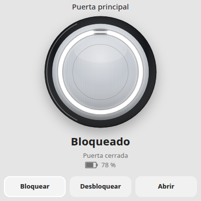
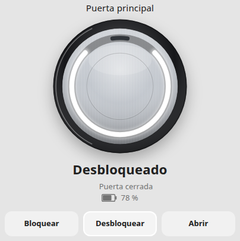
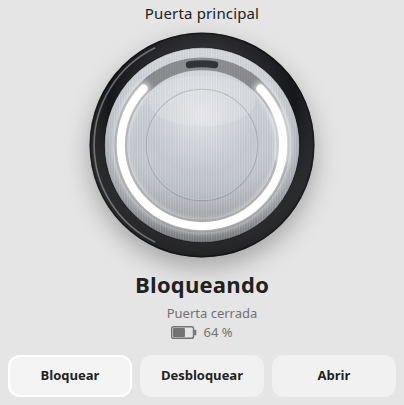
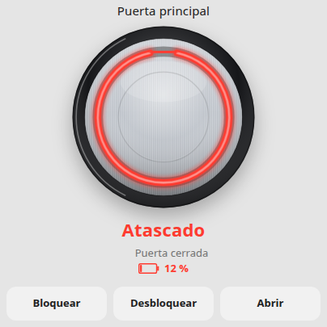
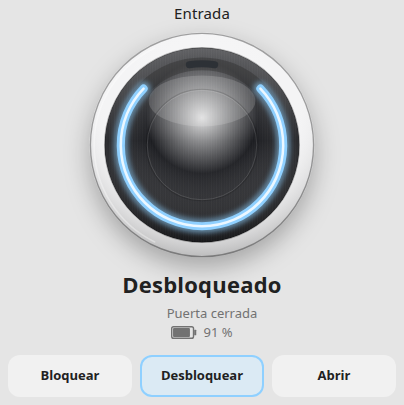

# Nuki Lock Card

Tarjeta Lovelace para el **Nuki Smart Lock Pro de 5.ª generación**. Dibuja el frontal del cilindro — cuerpo de metal cepillado y anillo LED — y lo conecta a la cerradura que Home Assistant ya expone por MQTT.

La configuración mínima es la entidad `lock`. La batería, el sensor de puerta y un indicador de atasco, si existen, se buscan entre las entidades del **mismo dispositivo**. No hay `entity_id` fijos.

| Bloqueado | Desbloqueado |
| --- | --- |
|  |  |
| Bloqueando | Atascado |
|  |  |

El acabado, el aro de la base y el color del anillo se cambian en la tarjeta. Ejemplo con cuerpo negro, aro blanco y anillo azul:



## Instalación con HACS

HACS trata esta tarjeta como un repositorio de tipo **Dashboard** (plugin de frontend).

1. HACS → **Dashboard**.
2. Menú (⋮) → **Repositorios personalizados**.
3. URL: `https://github.com/agasky74/nuki-card`
4. Categoría: **Dashboard**.
5. **Añadir** y, en la ficha, **Descargar**.
6. Recarga el navegador.

HACS suele registrar el recurso Lovelace solo. Si no aparece, añádelo a mano en **Ajustes → Paneles → menú (⋮) → Recursos**:

| URL | Tipo |
| --- | --- |
| `/hacsfiles/nuki-card/nuki-card.js` | Módulo JavaScript |

El archivo que sirve HACS es `dist/nuki-card.js` (también se adjunta a cada release de GitHub). Hace falta **Home Assistant 2024.4** o posterior.

## Instalación manual

1. Copia [`dist/nuki-card.js`](dist/nuki-card.js) a `config/www/nuki-card.js`.
2. Añade el recurso `/local/nuki-card.js` como **Módulo JavaScript**.
3. Recarga el navegador.

## Uso

En el selector de tarjetas aparece como **Nuki Lock**. El editor visual pide la cerradura (solo dominio `lock`) y los colores.

```yaml
type: custom:nuki-lock-card
entity: lock.puerta_principal
```

Si omites `entity` y en la casa hay **exactamente una** entidad `lock.*`, se usa esa. Si hay varias, la tarjeta pide que elijas una: no adivina.

```yaml
type: custom:nuki-lock-card
```

Aro base blanco (el Pro se entrega con aro negro y aro blanco) y anillo ligeramente cálido:

```yaml
type: custom:nuki-lock-card
entity: lock.puerta_principal
name: Puerta principal
body_finish: brushed
body_color: "#d5d8dc"
base_color: "#f4f4f5"
ring_color: "#fff6e8"
confirm_open: true
```

Entidades a mano, si la detección no encuentra la que quieres:

```yaml
type: custom:nuki-lock-card
entity: lock.puerta_principal
battery_entity: sensor.puerta_principal_bateria
door_entity: binary_sensor.puerta_principal_puerta
jammed_entity: binary_sensor.puerta_principal_atasco
language: es
low_battery: 20
```

Inglés, sin confirmación al abrir el pestillo:

```yaml
type: custom:nuki-lock-card
entity: lock.front_door
language: en
confirm_open: false
```

## Opciones

| Opción | Tipo | Por defecto | Qué hace |
| --- | --- | --- | --- |
| `entity` | `lock.*` | la única cerradura, si solo hay una | Entidad `lock` de Home Assistant |
| `name` | texto | nombre de la entidad | Título de la tarjeta |
| `battery_entity` | `sensor.*` | sensor de batería del mismo dispositivo | Sustituye la detección |
| `door_entity` | `binary_sensor.*` | sensor `device_class: door` del mismo dispositivo | Sustituye la detección. La puerta solo se muestra si hay entidad |
| `jammed_entity` | `binary_sensor.*` | sensor `problem` / `safety` del mismo dispositivo | Aviso de atasco además del estado `jammed` de la cerradura |
| `show_name` | bool | `true` | Muestra el título |
| `show_state` | bool | `true` | Muestra el estado escrito |
| `show_battery` | bool | `true` | Muestra el porcentaje |
| `show_door` | bool | `true` | Muestra la puerta si se encontró sensor |
| `show_buttons` | bool | `true` | Muestra Bloquear / Desbloquear / Abrir |
| `confirm_open` | bool | `true` | Pide confirmación antes de `lock.open` (pestillo) |
| `language` | `es` \| `en` \| `auto` | `es` | Textos de la tarjeta. `auto` usa el idioma de Home Assistant y, si no es español, inglés |
| `body_finish` | `brushed` \| `matte` \| `gloss` | `brushed` | Acabado del cuerpo: metal cepillado, mate o brillo |
| `body_color` | color CSS | `#c5cad1` | Color del cuerpo (plata por defecto) |
| `base_color` | color CSS | `#16171a` | Aro intercambiable de la base |
| `ring_color` | color CSS | `#ffffff` | Color del anillo LED |
| `warning_color` | color CSS | `#ff3b30` | Atasco, batería crítica y segmento de aviso |
| `low_battery` | número 0–100 | `20` | Por debajo de este porcentaje la batería se marca como baja |

Los colores admiten `#rgb`, `#rrggbb` o un nombre CSS (`white`, `silver`). En el editor se guardan en hexadecimal. Un valor igual al de fábrica no se escribe en el YAML.

## Detección de entidades

A partir de `entity` (o de la única cerradura):

1. Se lee `hass.entities[entity].device_id` en el registro de entidades del frontend.
2. Se recorren las entidades con ese mismo `device_id`.
3. La clase se toma de `hass.states[id].attributes.device_class` (el registro de pantalla no trae `device_class`).

| Qué | Cómo se elige |
| --- | --- |
| Batería | `sensor` con `device_class: battery` (o `%` y nombre de batería). Si hay varias, se prefiere la de la cerradura frente al teclado o al sensor de puerta |
| Batería crítica | `binary_sensor` con `device_class: battery`, evitando teclado y «door sensor» |
| Carga | `binary_sensor` con `device_class: battery_charging` |
| Puerta | `binary_sensor` con `device_class: door`. Una ventana del mismo dispositivo no cuenta |
| Atasco | `binary_sensor` con `device_class: problem` o `safety`, o un nombre que indique atasco |

`battery_entity`, `door_entity` y `jammed_entity` mandan sobre esa búsqueda, aunque la entidad sea de otro dispositivo.

El MQTT nativo de Nuki (descubrimiento de Home Assistant) publica la cerradura, la batería en %, el flag de batería crítica, la carga y —si hay Nuki Door Sensor— un binario `device_class: door`, todos en el mismo dispositivo. Esta tarjeta no habla MQTT: usa esas entidades.

## Anillo

El anillo imita la señal luminosa del Pro de 5.ª generación (círculo completo = cerrado, tres cuartos con el hueco arriba = abierto), dibujado en SVG:

| Estado de `lock` | Anillo |
| --- | --- |
| `locked` | Círculo completo, fijo, color del anillo |
| `unlocked` | Tres cuartos, hueco arriba, fijo |
| `locking` | Animación en el sentido del cierre |
| `unlocking` | Animación en sentido contrario |
| `opening` | Animación mientras abre el pestillo |
| `open` | Arco más corto, con pulso suave |
| `jammed` | Color de aviso, parpadeo |
| `unavailable` / `unknown` | Anillo apagado, parpadeo lento |

Con batería baja o crítica el **segmento superior** parpadea en el color de aviso, como el LED rojo del cerrojo, y el porcentaje se marca. Si hay un binario de atasco en `on` pero la cerradura sigue en otro estado, se muestra un aviso y ese mismo segmento.

## Acciones

| Botón | Servicio |
| --- | --- |
| Bloquear | `lock.lock` |
| Desbloquear | `lock.unlock` |
| Abrir | `lock.open` (unlatch / pestillo) |

Abrir pide confirmación salvo `confirm_open: false`. En el panel se usa el diálogo de Home Assistant; fuera de él, la tarjeta muestra el suyo. Si la entidad publica `supported_features` y no incluye abrir (`1`), el botón Abrir se oculta. Pulsar el cilindro abre el diálogo «más información» de la cerradura.

Los textos salen en español. Con `language: en` o `language: auto` (y Home Assistant en otro idioma) salen en inglés.

## Vista previa

`demo/index.html` carga `dist/nuki-card.js` con un objeto `hass` simulado (registro de entidades incluido). Tras `npm run build`:

```bash
python3 -m http.server 8765
```

Abre `http://localhost:8765/demo/` y `http://localhost:8765/demo/?shot=locked` (también `unlocked`, `locking`, `jammed`, `open`, `unavailable`, `low`, `custom`).

## Desarrollo

```bash
npm install
npm test
npm run build   # escribe dist/nuki-card.js
npm run dev     # sirve el repositorio en el puerto 5173
```

La tarjeta está en Lit + TypeScript. El bundle es un único módulo ES, sin dependencias externas: es el archivo que HACS instala.

## Qué comprobar en tu Home Assistant

La tarjeta no puede ver tu cerradura desde aquí. Conviene revisar:

1. **Versión.** 2024.4 o más nueva. `hass.entities` (con `device_id`) existe en el frontend desde 2023.2; 2024.4 es la base con la que está pensado el editor (`ha-entity-picker`) y `getGridOptions`.
2. **Mismo dispositivo.** En Ajustes → Dispositivos, la cerradura, el sensor de batería (%) y, si lo tienes, el sensor de puerta deben ser entidades del mismo dispositivo Nuki. Si la batería no aparece, el `device_id` no coincide o el sensor no tiene `device_class: battery`: indica `battery_entity` (y `door_entity`) en la tarjeta.
3. **Clase de la puerta.** Solo se detecta un `binary_sensor` con `device_class: door`. `on` = abierta, `off` = cerrada.
4. **`lock.open`.** Depende de que el descubrimiento MQTT de tu Nuki publique el comando de unlatch. Prueba el servicio en Herramientas de desarrollo. Si la cerradura no anuncia la función, el botón se oculta cuando `supported_features` viene sin el bit de abrir.
5. **Estado tras abrir el pestillo.** Según firmware, Home Assistant puede pasar a `open`, `opening` o quedarse en `unlocked`. La tarjeta pinta los tres.
6. **Recarga.** Después de instalar, recarga el navegador. El recurso tiene que ser un módulo JavaScript, no un script clásico.
